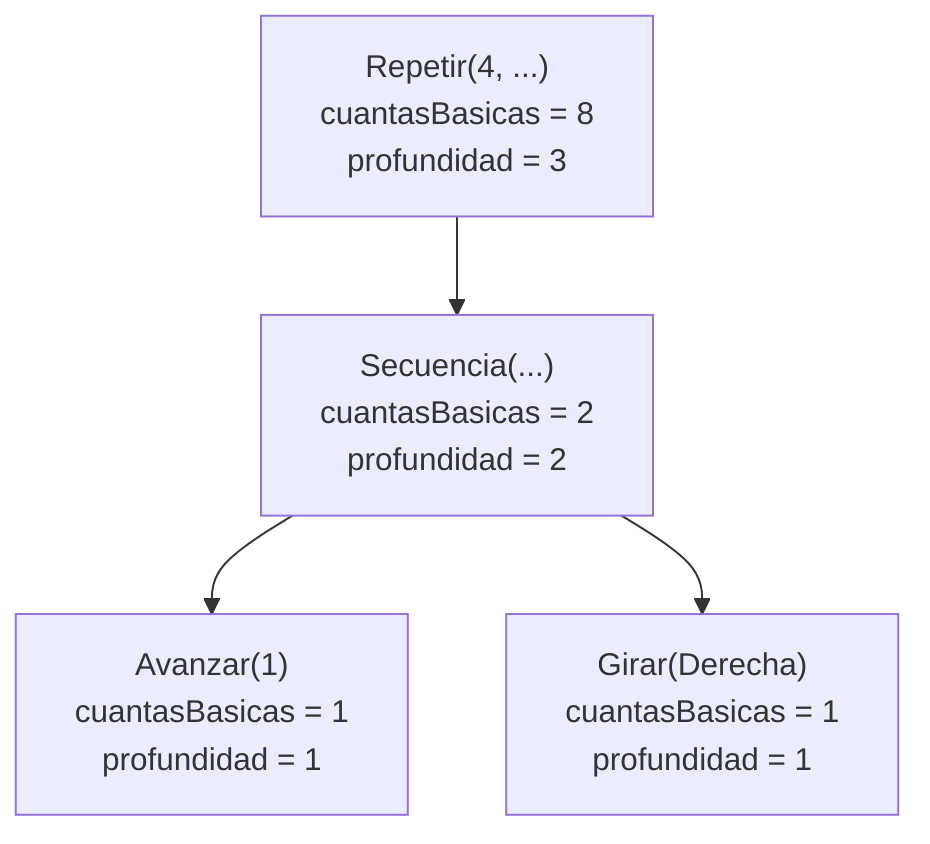
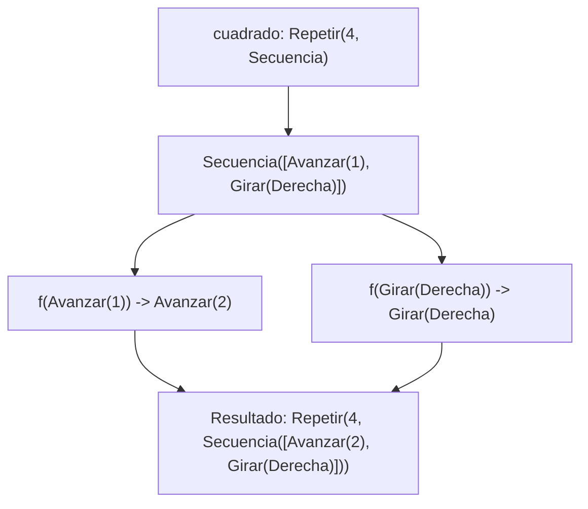
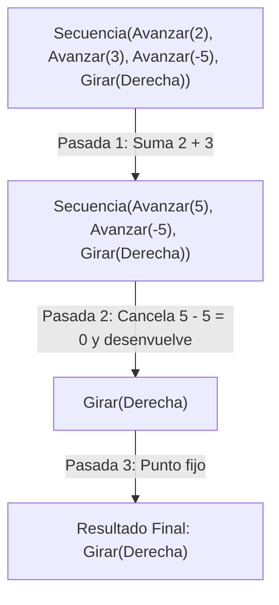

# Informe de Proceso 

Fundamentos de Programación Funcional y Concurrente  
Universidad del Valle


## Punto 3: `cuantasBasicas` y `profundidad`

### Definición

```scala
def cuantasBasicas(o: Orden): Int = o match {
  case Avanzar(_) => 1
  case Girar(_) => 1
  case Repetir(veces, orden) => veces * cuantasBasicas(orden)
  case Secuencia(ordenes)    => ordenes.map(cuantasBasicas).sum
}

def profundidad(o: Orden): Int = o match {
  case Avanzar(_) => 1
  case Girar(_) => 1
  case Repetir(_, orden)  => 1 + profundidad(orden)
  case Secuencia(ordenes) => 1 + ordenes.map(profundidad).foldLeft(0)((acu, actual) => math.max(acu, actual))
}
```

* Ambas son recursivas sobre la estructura de `Orden`: cada llamada recursiva se
  hace sobre una orden contenida en la actual, que es más pequeña, así que el
  proceso termina.
* `cuantasBasicas` cuenta las órdenes `Avanzar` y `Girar` que se ejecutan,
  contando cada repetición: `Repetir` multiplica y `Secuencia` suma.
* `profundidad` cuenta los niveles de anidamiento: una orden básica vale 1 y una
  compuesta vale uno más que la más honda de las que contiene.
* No usan `var`, bucles ni `return`.

### Traza de `cuantasBasicas` sobre el cuadrado

Sea `c = Repetir(4, Secuencia(List(Avanzar(1), Girar(Derecha))))`.

```text
cuantasBasicas(c)
= 4 * cuantasBasicas(Secuencia(List(Avanzar(1), Girar(Derecha))))              // caso Repetir
= 4 * List(cuantasBasicas(Avanzar(1)), cuantasBasicas(Girar(Derecha))).sum     // caso Secuencia
= 4 * List(1, 1).sum                                                           // casos básicos
= 4 * 2
= 8
```

### Traza de `profundidad` sobre el cuadrado

```text
profundidad(c)
= 1 + profundidad(Secuencia(List(Avanzar(1), Girar(Derecha))))                 // caso Repetir
= 1 + (1 + List(profundidad(Avanzar(1)), profundidad(Girar(Derecha))).foldLeft(0)(max))
= 1 + (1 + List(1, 1).foldLeft(0)(max))                                        // casos básicos
```

El `foldLeft` avanza así:

| Paso | `a` (acumulador) | `b` (elemento) | `max(a, b)` |
|---|---|---|---|
| 1 | 0 | 1 | 1 |
| 2 | 1 | 1 | 1 |

```text
= 1 + (1 + 1)
= 3
```

### Casos borde

* `cuantasBasicas(Secuencia(Nil)) = Nil.sum = 0`.
* `profundidad(Secuencia(Nil)) = 1 + Nil.foldLeft(0)(max) = 1 + 0 = 1`.
* `cuantasBasicas(Repetir(0, o)) = 0 * cuantasBasicas(o) = 0`.

### Diagrama: valores de cada nodo del cuadrado



---

## Punto 4: Rutinas con Funciones de Alto Orden

### Traza de `transformar`
Tomamos `cuadrado = Repetir(4, Secuencia(List(Avanzar(1), Girar(Derecha))))` y la función $f$ que duplica los avances:

1. **Llamada:** `transformar(cuadrado, f)`
2. **Paso 1:** Al ser `Repetir(4, _)`, conserva el bucle y desciende recursivamente a la suborden.
3. **Paso 2:** Al ser `Secuencia(_)`, procesa su lista elemento por elemento:
   - `Avanzar(1)` (básica) $\implies$ aplica $f \implies \text{Avanzar}(2)$.
   - `Girar(Derecha)` (básica) $\implies$ aplica $f \implies \text{Girar(Derecha)}$.
4. **Resultado final:** `Repetir(4, Secuencia(List(Avanzar(2), Girar(Derecha))))`.



---

## Punto 5: `simplificar` en Múltiples Pasadas

Consideremos la siguiente orden que requiere varias pasadas de optimización:
$$\text{Secuencia}(\text{List}(\text{Avanzar}(2), \text{Avanzar}(3), \text{Avanzar}(-5), \text{Girar}(\text{Derecha})))$$

### Traza paso a paso:

- **Pasada 1 (Fusión de avances contiguos):**
  - Detecta `Avanzar(2)` y `Avanzar(3)` consecutivos $\implies$ los suma en `Avanzar(5)`.
  - Queda: `Secuencia(List(Avanzar(5), Avanzar(-5), Girar(Derecha)))`.

- **Pasada 2 (Cancelación y desenvolvimiento):**
  - Detecta `Avanzar(5)` y `Avanzar(-5)` $\implies$ $5 + (-5) = 0$, se cancelan y desaparecen.
  - Queda: `Secuencia(List(Girar(Derecha)))`.
  - Por regla de elemento único, la secuencia se desenvuelve en: `Girar(Derecha)`.

- **Pasada 3 (Verificación de punto fijo):**
  - `Girar(Derecha)` no admite más reducciones $\implies$ el resultado no cambia y termina el proceso.



