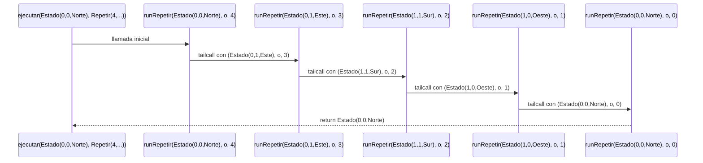
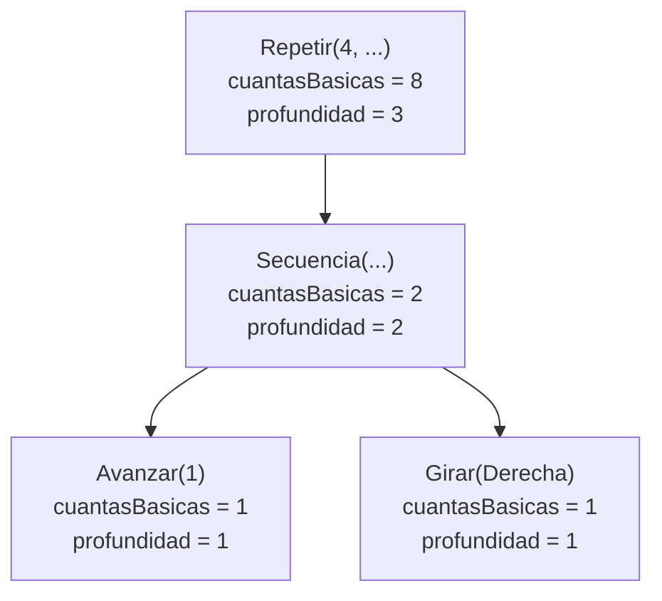
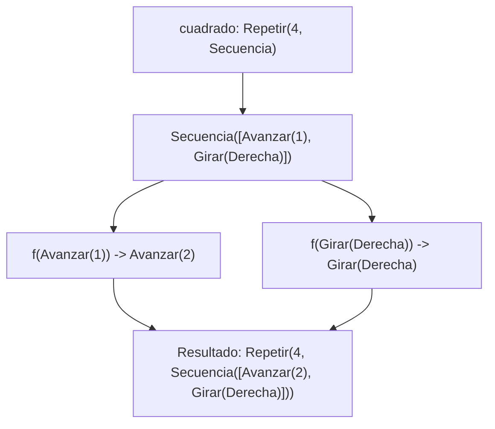
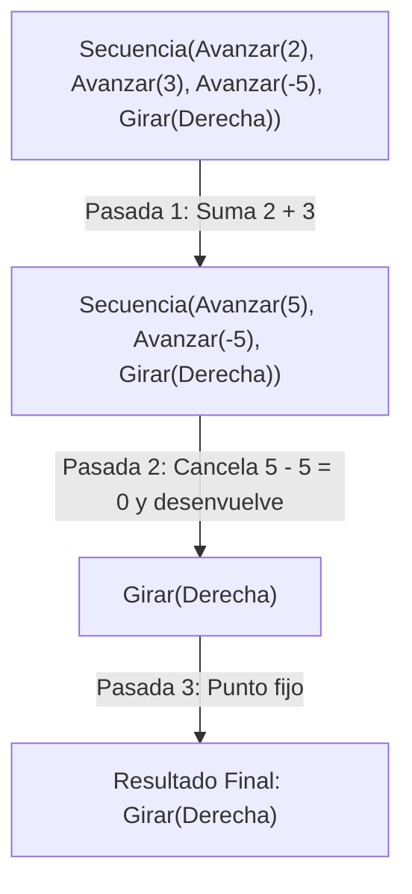

# Informe de Proceso 

Fundamentos de Programación Funcional y Concurrente  
Universidad del Valle


## Punto 2: `ejecutar`
### Definición del Algoritmo

```scala
def ejecutar(e: Estado, o: Orden): Estado = {
  def runSecuencia(e: Estado, l: List[Orden]): Estado = {
    l match{
      case Nil => e
      case x :: Nil => ejecutar(e,x)
      case x :: xs => runSecuencia(ejecutar(e,x),xs)
    }
  }

  def runRepetir(e: Estado, o: Orden, n: Int): Estado = {
    if (n == 0) e
    else runRepetir(ejecutar(e,o),o,n-1)
  }

  (e, o) match{
    case (Estado(x,y,dir),Avanzar(n)) if dir == Norte => Estado(x,y+n,dir)
    case (Estado(x,y,dir),Avanzar(n)) if dir == Sur => Estado(x,y-n,dir)
    case (Estado(x,y,dir),Avanzar(n)) if dir == Este => Estado(x+n,y,dir)
    case (Estado(x,y,dir),Avanzar(n)) if dir == Oeste => Estado(x-n,y,dir)
    case (Estado(x,y,dir),Girar(sentido)) => Estado(x,y,girar(dir,sentido))
    case (e,Secuencia(List())) => e
    case (e,Secuencia(lista)) => runSecuencia(e,lista)
    case (e,Repetir(n,_)) if n < 1 => e
    case (e,Repetir(n,orden)) => runRepetir(e,orden,n)
  }
}
```
* La función `ejecutar` aplica una Orden `o` a un Estado `e`, y devuelve el Estado resultante. Es recursiva en los casos donde `o` es `Secuencia` o `Repetición`.

* La función interna `runSecuencia` recorre la lista de ordenes y llama a ejecutar con el estado y la cabeza. Si hay cola se llama así misma, usando a ejecutar con el estado y la cabeza como estado y la cola como la lista.

  * Recibe dos parametros:

    * `e`: El estado a la que se le darán las ordenes.
    * `l`: La lista de ordenes.

* La función interna `runRepetir` repite una orden `n` cantidad de veces. 

  * Recibe tres parametros:

    * `e`: El estado a la que se le darán las ordenes.
    * `o`: La orden a ejecutar.
    * `n`: El numero de veces que se repite una orden, decrece hasta llegar a 0.

### Explicación Paso a Paso
#### Casos de Avanzar
```scala
1. case (Estado(x,y,dir),Avanzar(n)) if dir == Norte => Estado(x,y+n,dir)
2. case (Estado(x,y,dir),Avanzar(n)) if dir == Sur => Estado(x,y-n,dir)
3. case (Estado(x,y,dir),Avanzar(n)) if dir == Este => Estado(x+n,y,dir)
4. case (Estado(x,y,dir),Avanzar(n)) if dir == Oeste => Estado(x-n,y,dir)
```
Se aumenta `y` cuando mira al **Norte** y disminuye cuando mira al **Sur**, o se aumenta `x` cuando mira al **Este** y disminuye cuando mira al **Oeste**. Posteriormente se retorna un Estado con estos valores.

#### Caso Girar
```scala
case (Estado(x,y,dir),Girar(sentido)) => Estado(x,y,girar(dir,sentido))
```
Se cambia la dirección del Estado (`dir`) utilizando la función `Girar`, que toma como argumentos `dir` y `sentido`. La función retorna un Estado con los mismos valores de `x` y `y`, y con la dirección resultante.

#### Caso Secuencia - Base
```scala
case Nil => e
```
En caso de obtener una lista vacía se retorna el Estado directamente.
#### Caso Secuencia - Recursivo
```scala
1. case x :: Nil => ejecutar(e,x)
2. case x :: xs => runSecuencia(ejecutar(e,x),xs)
```
1. Solo queda la cabeza. Se ejecuta la orden y se retorna el Estado resultante.
2. En cada llamada:
    * Se ejecuta la orden en `x` al Estado y se obtiene el Estado resultante.
    * Se coloca la cola como argumento de `runSecuencia` y se pasa junto al Estado resultante a la siguiente iteración.
#### Caso Repetir - Base
```scala
if (n == 0) e
```
Cuando `n` llega a 0 se retorna el Estado final, evitando que hayan más llamadas.
#### Caso Repetir - Recursivo
```scala
else runRepetir(ejecutar(e,o),o,n-1)
```
En cada llamada:
* Se reduce el valor de `n`.
* Se obtiene el estado resultante y se pasa junto a la orden y el `n` reducido a la siguiente iteración.

### Llamados de Pila
Ejemplo:
```scala
ejecutar(Estado(0,0,Norte),Repetir(4, Secuencia(List(Avanzar(1), Girar(Derecha)))))
```
#### Paso 1: Llamada Inicial. Pasa por el caso `(e,Repetir(n,orden))`.
```scala
runRepetir(Estado(0,0,Norte), Secuencia(List(Avanzar(1), Girar(Derecha))), 4) 
// Estado actual: (0,0,Norte) | Siguiente: (0,1,Este) [+1 Y, Giro Der]
// Falta: [Avanzar(1),Girar(Derecha)] 4 veces
```
En cada llamada, siempre se aplican las ordenes de la Secuencia: `Avanzar(1)` y `Girar(Derecha)`.

#### Paso 2: Primera Iteración
```scala
runRepetir(Estado(0,1,Este), Secuencia(List(Avanzar(1), Girar(Derecha))), 3)
// Estado actual: (0,1,Este) | Siguiente: (1,1,Sur) [+1 X, Giro Der]
// Falta: [Avanzar(1),Girar(Derecha)] 3 veces
```
#### Paso 3: Segunda Iteración
```scala
runRepetir(Estado(1,1,Sur), Secuencia(List(Avanzar(1), Girar(Derecha))), 2)
// Estado actual: (1,1,Sur) | Siguiente: (1,0,Oeste) [-1 Y, Giro Der]
// Falta: [Avanzar(1),Girar(Derecha)] 2 veces
```
#### Paso 4: Tercera Iteración
```scala
runRepetir(Estado(1,0,Oeste), Secuencia(List(Avanzar(1), Girar(Derecha))), 1)
// Estado actual: (1,0,Oeste) | Siguiente: (0,0,Norte) [-1 X, Giro Der]
// Falta: [Avanzar(1),Girar(Derecha)] 1 vez
```
#### Paso 5: Caso Base
```scala
return Estado(0,0,Norte)
// Estado actual: (0,0,Norte)
// Falta: Nada. Llegó al caso base ya que n == 0.
```
---
### Ejemplo de Uso
```scala
val res = ejecutar(Estado(0,0,Norte),Repetir(4,Secuencia(List(Avanzar(1),Giro(Derecha)))))
println(res) // Estado(0,0,Norte)
```

El resultado de `ejecutar(Estado(0,0,Norte), Repetir(4, Secuencia(List(Avanzar(1), Giro(Derecha)))))` es Estado(0,0,Norte).

---

### Diagrama de Llamados


* El segundo argumento, `o`, es la secuencia de ordenes.
---
## Punto 3: `cuantasBasicas` y `profundidad`

### Definición

```scala
def cuantasBasicas(o: Orden): Int = o match {
  case Avanzar(_) => 1
  case Girar(_) => 1
  case Repetir(veces, orden) => veces * cuantasBasicas(orden)
  case Secuencia(ordenes)    => ordenes.map(cuantasBasicas).sum
}

def profundidad(o: Orden): Int = o match {
  case Avanzar(_) => 1
  case Girar(_) => 1
  case Repetir(_, orden)  => 1 + profundidad(orden)
  case Secuencia(ordenes) => 1 + ordenes.map(profundidad).foldLeft(0)((acu, actual) => math.max(acu, actual))
}
```

* Ambas son recursivas sobre la estructura de `Orden`: cada llamada recursiva se
  hace sobre una orden contenida en la actual, que es más pequeña, así que el
  proceso termina.
* `cuantasBasicas` cuenta las órdenes `Avanzar` y `Girar` que se ejecutan,
  contando cada repetición: `Repetir` multiplica y `Secuencia` suma.
* `profundidad` cuenta los niveles de anidamiento: una orden básica vale 1 y una
  compuesta vale uno más que la más honda de las que contiene.
* No usan `var`, bucles ni `return`.

### Traza de `cuantasBasicas` sobre el cuadrado

Sea `c = Repetir(4, Secuencia(List(Avanzar(1), Girar(Derecha))))`.

```text
cuantasBasicas(c)
= 4 * cuantasBasicas(Secuencia(List(Avanzar(1), Girar(Derecha))))              // caso Repetir
= 4 * List(cuantasBasicas(Avanzar(1)), cuantasBasicas(Girar(Derecha))).sum     // caso Secuencia
= 4 * List(1, 1).sum                                                           // casos básicos
= 4 * 2
= 8
```

### Traza de `profundidad` sobre el cuadrado

```text
profundidad(c)
= 1 + profundidad(Secuencia(List(Avanzar(1), Girar(Derecha))))                 // caso Repetir
= 1 + (1 + List(profundidad(Avanzar(1)), profundidad(Girar(Derecha))).foldLeft(0)(max))
= 1 + (1 + List(1, 1).foldLeft(0)(max))                                        // casos básicos
```

El `foldLeft` avanza así:

| Paso | `a` (acumulador) | `b` (elemento) | `max(a, b)` |
|---|---|---|---|
| 1 | 0 | 1 | 1 |
| 2 | 1 | 1 | 1 |

```text
= 1 + (1 + 1)
= 3
```

### Casos borde

* `cuantasBasicas(Secuencia(Nil)) = Nil.sum = 0`.
* `profundidad(Secuencia(Nil)) = 1 + Nil.foldLeft(0)(max) = 1 + 0 = 1`.
* `cuantasBasicas(Repetir(0, o)) = 0 * cuantasBasicas(o) = 0`.

### Diagrama: valores de cada nodo del cuadrado



---

## Punto 4: Rutinas con Funciones de Alto Orden

### Traza de `transformar`
Tomamos `cuadrado = Repetir(4, Secuencia(List(Avanzar(1), Girar(Derecha))))` y la función $f$ que duplica los avances:

1. **Llamada:** `transformar(cuadrado, f)`
2. **Paso 1:** Al ser `Repetir(4, _)`, conserva el bucle y desciende recursivamente a la suborden.
3. **Paso 2:** Al ser `Secuencia(_)`, procesa su lista elemento por elemento:
   - `Avanzar(1)` (básica) $\implies$ aplica $f \implies \text{Avanzar}(2)$.
   - `Girar(Derecha)` (básica) $\implies$ aplica $f \implies \text{Girar(Derecha)}$.
4. **Resultado final:** `Repetir(4, Secuencia(List(Avanzar(2), Girar(Derecha))))`.



---

## Punto 5: `simplificar` en Múltiples Pasadas

Consideremos la siguiente orden que requiere varias pasadas de optimización:
$$\text{Secuencia}(\text{List}(\text{Avanzar}(2), \text{Avanzar}(3), \text{Avanzar}(-5), \text{Girar}(\text{Derecha})))$$

### Traza paso a paso:

- **Pasada 1 (Fusión de avances contiguos):**
  - Detecta `Avanzar(2)` y `Avanzar(3)` consecutivos $\implies$ los suma en `Avanzar(5)`.
  - Queda: `Secuencia(List(Avanzar(5), Avanzar(-5), Girar(Derecha)))`.

- **Pasada 2 (Cancelación y desenvolvimiento):**
  - Detecta `Avanzar(5)` y `Avanzar(-5)` $\implies$ $5 + (-5) = 0$, se cancelan y desaparecen.
  - Queda: `Secuencia(List(Girar(Derecha)))`.
  - Por regla de elemento único, la secuencia se desenvuelve en: `Girar(Derecha)`.

- **Pasada 3 (Verificación de punto fijo):**
  - `Girar(Derecha)` no admite más reducciones $\implies$ el resultado no cambia y termina el proceso.



