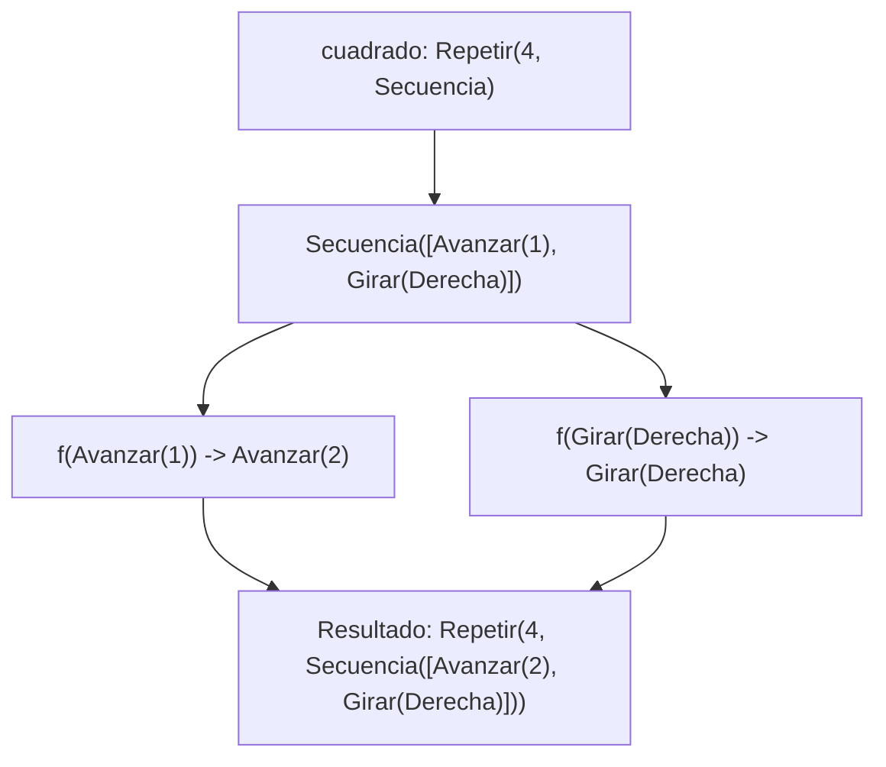
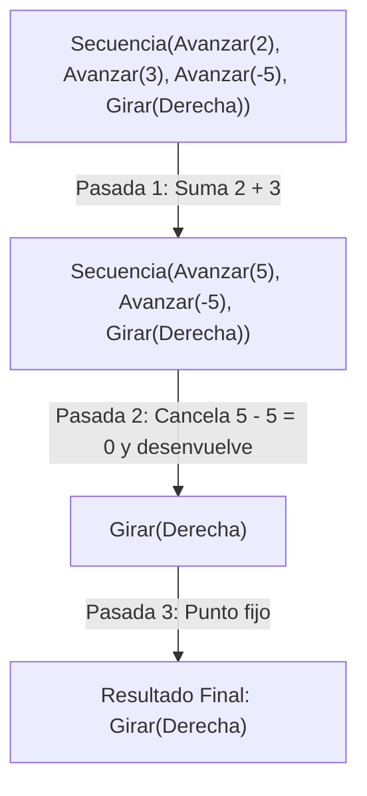

# Informe de Proceso — Puntos 4 y 5

Fundamentos de Programación Funcional y Concurrente  
Universidad del Valle

---

## Punto 4: Rutinas con Funciones de Alto Orden

### Traza de `transformar`
Tomamos `cuadrado = Repetir(4, Secuencia(List(Avanzar(1), Girar(Derecha))))` y la función $f$ que duplica los avances:

1. **Llamada:** `transformar(cuadrado, f)`
2. **Paso 1:** Al ser `Repetir(4, _)`, conserva el bucle y desciende recursivamente a la suborden.
3. **Paso 2:** Al ser `Secuencia(_)`, procesa su lista elemento por elemento:
   - `Avanzar(1)` (básica) $\implies$ aplica $f \implies \text{Avanzar}(2)$.
   - `Girar(Derecha)` (básica) $\implies$ aplica $f \implies \text{Girar(Derecha)}$.
4. **Resultado final:** `Repetir(4, Secuencia(List(Avanzar(2), Girar(Derecha))))`.

---

## Punto 5: `simplificar` en Múltiples Pasadas

Consideremos la siguiente orden que requiere varias pasadas de optimización:
$$\text{Secuencia}(\text{List}(\text{Avanzar}(2), \text{Avanzar}(3), \text{Avanzar}(-5), \text{Girar}(\text{Derecha})))$$

### Traza paso a paso:

- **Pasada 1 (Fusión de avances contiguos):**
  - Detecta `Avanzar(2)` y `Avanzar(3)` consecutivos $\implies$ los suma en `Avanzar(5)`.
  - Queda: `Secuencia(List(Avanzar(5), Avanzar(-5), Girar(Derecha)))`.

- **Pasada 2 (Cancelación y desenvolvimiento):**
  - Detecta `Avanzar(5)` y `Avanzar(-5)` $\implies$ $5 + (-5) = 0$, se cancelan y desaparecen.
  - Queda: `Secuencia(List(Girar(Derecha)))`.
  - Por regla de elemento único, la secuencia se desenvuelve en: `Girar(Derecha)`.

- **Pasada 3 (Verificación de punto fijo):**
  - `Girar(Derecha)` no admite más reducciones $\implies$ el resultado no cambia y termina el proceso.

